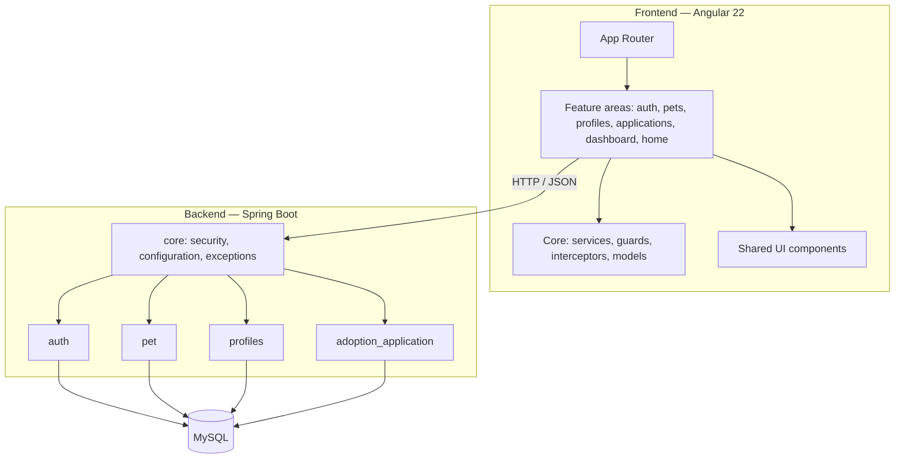
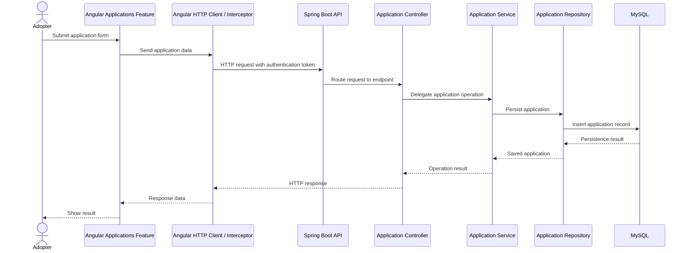

# LoveFound — Application Structure

This guide explains how the Angular frontend and Spring Boot backend are organized, and how their main features connect. It is intended as a developer-oriented map of the two repositories.

## 1. Two-repository organization

LoveFound is split into a frontend repository and a backend repository. They are separate codebases, but together they form one application.



## 2. Frontend structure

Repository: [love-found-frontend](https://github.com/islemzaafouri/love-found-frontend)

The Angular application uses a feature-based structure. Each feature groups the UI related to a user-facing part of LoveFound, while common application services and reusable components are kept in dedicated folders.

```text
src/app/
├── core/
│   ├── guards/
│   ├── interceptors/
│   ├── models/
│   └── services/
├── features/
│   ├── applications/
│   ├── auth/
│   ├── dashboard/
│   ├── home/
│   ├── pets/
│   ├── profile/
│   └── shelter-pets-component/
└── shared/
    └── components/
```

### Main frontend areas

| Area | Responsibility |
|---|---|
| `core/services` | Shared services for communicating with the API and managing application-level state. |
| `core/interceptors` | Centralizes HTTP request handling, including attaching authentication information to API calls. |
| `core/guards` | Controls access to routes based on authentication and user role. |
| `core/models` | Holds TypeScript models and interfaces used across features. |
| `features/auth` | Login and registration experiences for adopters and shelters. |
| `features/pets` | Pet browsing, details, and pet-related screens. |
| `features/applications` | Adoption application submission and application management screens. |
| `features/profile` | Adopter and shelter profile screens. |
| `features/dashboard` | Shelter dashboard experience. |
| `features/home` | Public landing page. |
| `shared/components` | Reusable interface elements such as the navigation bar and footer. |

The application routes are defined in `app.routes.ts`. Feature routes are lazy-loaded, and guards are used for protected, role-specific pages.

## 3. Backend structure

Repository: [love-found-api](https://github.com/islemzaafouri/love-found-api)

The backend is organized by business domain. The main feature packages are `auth`, `pet`, `profiles`, and `adoption_application`. Within these areas, the code is separated into responsibilities such as controllers, DTOs, services, repositories, and models/entities.

```text
src/main/java/com/lovefound/love_found_api/
├── auth/
│   ├── controller/
│   ├── dto/
│   ├── model/
│   ├── repository/
│   └── service/
├── pet/
│   ├── controller/
│   ├── dto/
│   ├── model/
│   ├── repository/
│   ├── service/
│   └── PetMapper.java
├── profiles/
│   ├── dto/
│   ├── entities/
│   ├── enums/
│   ├── Repos/
│   ├── service/
│   ├── ProfileController.java
│   └── ProfileMapper.java
├── adoption_application/
│   ├── controllers/
│   ├── dto/
│   ├── models/
│   ├── repository/
│   └── services/
└── core/
    ├── config/
    ├── exceptions/
    ├── security/
    └── GlobaExceptionHandler.java
```

### Main backend domains

| Package | Responsibility |
|---|---|
| `auth` | User registration, login, authentication-related DTOs and persistence. |
| `pet` | Pet listing operations, pet data, persistence, and mapping between entities and DTOs. |
| `profiles` | Adopter and shelter profile operations, profile entities, DTOs, and mapping. |
| `adoption_application` | Adoption application creation, retrieval, updates, persistence, and status management. |
| `core/security` | Shared authentication and authorization infrastructure, including JWT-related components. |
| `core/config` | Shared application configuration. |
| `core/exceptions` | Shared exception handling and error responses. |

### Typical backend feature flow

A typical API operation follows this path:

1. A controller exposes an endpoint and receives the HTTP request.
2. A DTO represents the request data.
3. The service performs the operation and applies business rules.
4. A repository accesses the database through JPA.
5. The controller returns an HTTP response, commonly using a response DTO.

This separation keeps HTTP handling, business rules, and persistence responsibilities distinct.

## 4. How a frontend feature reaches the backend

For example, when an adopter submits an adoption application:



The sequence is a conceptual example of the feature interaction. Exact method names and response details can evolve with the implementation.

## 5. API areas used by the frontend

| Feature | API base path |
|---|---|
| Authentication | `/api/auth` |
| Pets | `/api/pets` |
| Profiles | `/api/profile` |
| Adoption applications | `/api/applications` |

See the [backend README](../README.md) for the endpoint overview and the [system architecture](architecture.md) for the wider component view.

## 6. Related documentation

- [System architecture](architecture.md)
- [Database design and ER diagram](database-design.md)
- [Frontend repository](https://github.com/islemzaafouri/love-found-frontend)
- [Backend repository](https://github.com/islemzaafouri/love-found-api)

---

*This guide describes the repository organization and the main architectural responsibilities. The source code remains the authoritative reference for implementation details.*
