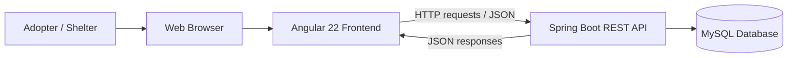
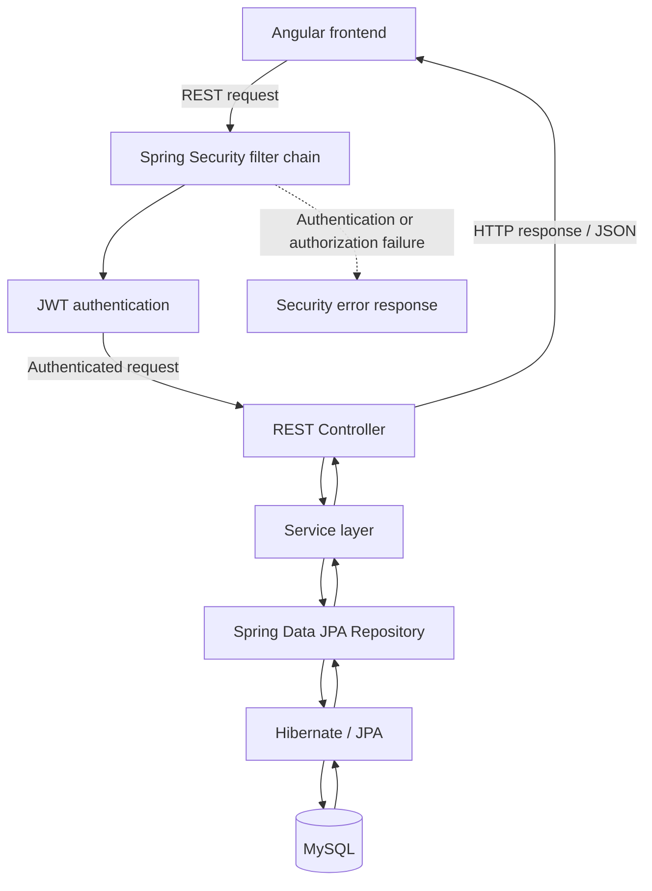

# LoveFound — System Architecture

This document describes how the two LoveFound repositories work together. It is a high-level view of the current application, not a deployment diagram.

## 1. System context

LoveFound is a web-based pet adoption platform. Adopters and shelters use the Angular application in a browser. The frontend communicates with the Spring Boot backend through HTTP requests to its REST API.

## 2. Backend request flow

The backend separates HTTP handling, business logic, and data access. Protected requests pass through the Spring Security and JWT authentication layer before reaching the relevant API functionality.

### Main backend responsibilities

| Layer | Responsibility |
|---|---|
| Security | Processes authentication and role-based access for protected requests. |
| Controllers | Expose REST endpoints and handle incoming HTTP requests. |
| DTOs | Define the data accepted from and returned to the frontend. |
| Services | Apply application rules and coordinate operations. |
| Repositories | Read and write persistent data through Spring Data JPA. |
| Entities | Represent the application's persisted domain data. |
| Flyway | Applies versioned database migrations. |

## 3. Main functional areas

The backend is organized around the main domains of the application:

- **Authentication:** adopter and shelter registration, login, and JWT-based authentication.
- **Pets:** browsing pet listings and shelter management of their listings.
- **Profiles:** adopter and shelter profile information.
- **Adoption applications:** submission, viewing, cancellation, and review of applications.

The frontend mirrors these user-facing areas through feature-based Angular routes and components.

## 4. Authentication flow

1. A user submits login details through the Angular application.
2. The frontend sends the login request to the authentication API.
3. The backend authenticates the user and returns an authentication response containing a JWT.
4. The frontend retains the token for subsequent authenticated API requests.
5. The HTTP interceptor attaches the token to protected requests.
6. The backend validates the token and applies the relevant role-based access rules.

## 5. Repository map

| Repository | Responsibility | Main technologies |
|---|---|---|
| [love-found-frontend](https://github.com/islemzaafouri/love-found-frontend) | Browser interface, routing, forms, and API communication | Angular, TypeScript, RxJS, SCSS |
| [love-found-api](https://github.com/islemzaafouri/love-found-api) | REST API, business logic, authentication, and persistence | Java, Spring Boot, Spring Security, JPA, MySQL |

## 6. Related documentation

- [Frontend repository and setup](https://github.com/islemzaafouri/love-found-frontend)
- [Backend repository and API overview](https://github.com/islemzaafouri/love-found-api)

---

*The diagrams are conceptual representations of the application architecture. They focus on the main components and request flow rather than every class or runtime configuration detail.*
