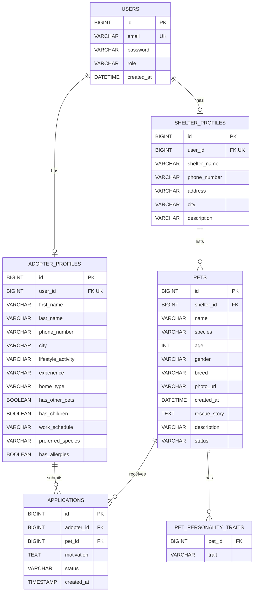
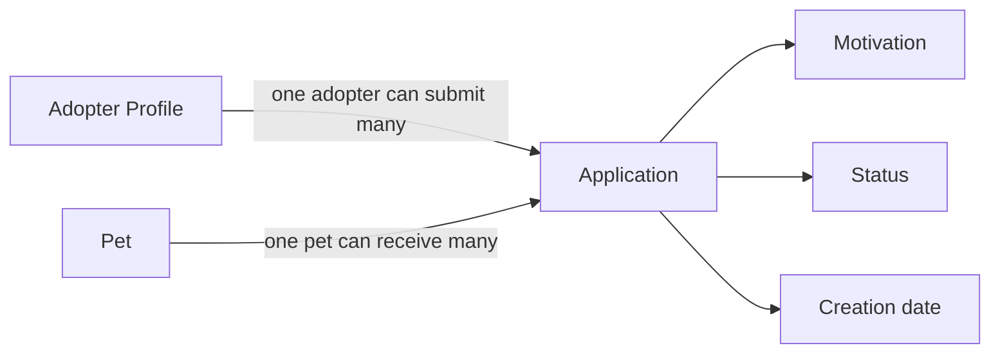

# LoveFound — Database Design

This document describes the relational schema created by the Flyway SQL migrations in `src/main/resources/db/migration/`.

## 1. Entity-relationship diagram

The diagram below is based on the current migration definitions. It shows the main tables, their primary and foreign keys, and the relationships between them.

**Reading the relationships:**

- A user can have an adopter profile or a shelter profile. Each profile belongs to one user; the profile's `user_id` is unique.
- A shelter profile can list multiple pets. Each pet belongs to one shelter.
- A pet can have multiple personality traits. Traits are stored in a separate collection table.
- An adopter can submit multiple applications.
- A pet can receive applications from multiple adopters.

The diagram uses optional profile participation because the schema does not require every user row to have a corresponding profile row.

## 2. Table responsibilities

| Table | Purpose |
|---|---|
| `users` | Stores login identity, email, password hash value, role, and account creation time. |
| `adopter_profiles` | Stores adopter-specific personal information and adoption preferences. |
| `shelter_profiles` | Stores shelter information and contact details. |
| `pets` | Stores pet listings and links each listing to its shelter. |
| `pet_personality_traits` | Stores the personality traits associated with each pet. |
| `applications` | Stores an adopter's application for a specific pet, including motivation and status. |

## 3. Important database constraints

- **Unique user email:** `users.email` cannot be duplicated.
- **One profile per user per profile table:** `adopter_profiles.user_id` and `shelter_profiles.user_id` are each unique.
- **One application per adopter and pet:** `applications` has a unique constraint on `(adopter_id, pet_id)`. This prevents the same adopter from creating multiple application rows for the same pet.
- **Allowed application statuses:** the database check constraint accepts `PENDING`, `ACCEPTED`, `REJECTED`, and `CANCELLED`.
- **Referential integrity:** foreign keys connect profiles to users, pets to shelters, traits to pets, and applications to adopters and pets.
- **Cascade deletes:** the migrations configure cascading deletion for the profile/user, pet/shelter, pet/trait, and application relationships as defined by their foreign keys.

## 4. Adoption application relationship

The `applications` table connects adopters and pets. Conceptually, this is a many-to-many relationship resolved through an associative entity:

Each application records the adopter, the selected pet, the motivation text, its current status, and its creation timestamp.

## 5. Schema source

The diagram and descriptions are based on these migration files:

- [V1 — Initial schema](../src/main/resources/db/migration/V1__init_schema.sql)
- [V2 — Applications table](../src/main/resources/db/migration/V2__init_schema.sql)
- [V3 — Cascade delete constraints](../src/main/resources/db/migration/V3__add_cascade_deletes.sql)

> This document reflects the schema defined by the migrations. It does not replace the SQL migration files, which remain the source of truth for database structure.
